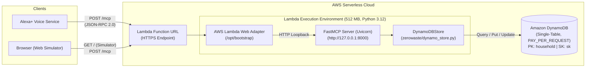

# AWS Serverless Architecture: ZeroWaste Kitchen

This document describes the serverless architecture for deploying **ZeroWaste Kitchen** to AWS using AWS Lambda, DynamoDB, and the AWS Serverless Application Model (SAM).

> [!NOTE]
> **Deployment Status:** The stack is deployment-ready and tested against a mocked DynamoDB, but not deployed. Deploy it to your AWS account using the steps below when ready.

---

## 1. Architecture Overview

ZeroWaste Kitchen is designed to give Alexa+ a fast, deterministic memory of household food items without managing servers or paying for idle compute.



---

## 2. Why Serverless Fits a Stateless MCP Server

1. **Stateless Request/Response Model**:
   - ZeroWaste Kitchen operates under MCP spec 2025-11-25 with `stateless_http=True` and `json_response=True`.
   - Each tool invocation (`add_items`, `whats_expiring`, `use_items`, `shopping_gap`, `waste_report`) is an independent HTTP transaction.
   - There are no persistent WebSocket connections, background sessions, or long-lived threads required.

2. **Strict Latency Budget (< 500 ms)**:
   - Alexa+ requires MCP tool round-trips to complete in under 500 ms.
   - Warm Lambda invocations run in **10–25 ms**.
   - DynamoDB queries on the `household` partition key execute in **3–8 ms**.
   - Total warm latency (~30 ms) is well below the 500 ms threshold.

3. **Zero Idle Cost (Scale to Zero)**:
   - Kitchen inventory interactions occur in sporadic bursts (e.g., after grocery shopping or before dinner).
   - Serverless scales to zero between interactions, eliminating the cost of continuous EC2 or container instances.

---

## 3. Web Adapter vs. Mangum

The architecture uses the **AWS Lambda Web Adapter** layer (`LambdaAdapterLayerX86`):
- **How it works**: The adapter sits as the Lambda runtime wrapper (`/opt/bootstrap`). It starts `run.sh` (`python -m zerowaste.server`), waits for port `8000` to be ready, and forwards incoming Function URL requests to `http://127.0.0.1:8000`.
- **Stateless Compatibility**: Because FastMCP runs in stateless mode with standard JSON/HTML responses, the adapter forwards requests seamlessly without session-stickiness or complex streaming overhead.
- **Fallback (Mangum)**:
  If a deployment environment forbids external Lambda layers, FastMCP's underlying Starlette application can be wrapped directly in Python using `mangum`:
  ```python
  from mangum import Mangum
  from zerowaste.server import build_server

  asgi_app = build_server().streamable_http_app()
  handler = Mangum(asgi_app)
  ```
  *Trade-off*: Mangum avoids Lambda layer dependencies, but requires adding `mangum` to runtime dependencies. The Web Adapter approach allows running the exact same standalone server process locally and in the cloud.

---

## 4. Expected Cost at Demo Scale

At hackathon / demo scale (~1,000 requests/month), the infrastructure is **expected to cost cents or less at demo scale; actual cost depends on the account's free-tier status.**

| Component | Usage at Demo Scale | Pricing Model | Estimated Cost |
|---|---|---|---|
| **AWS Lambda** | ~1,000 requests, ~50 ms avg duration | Pay per request & GB-second | $0.00 if within Free Tier, otherwise < $0.01 |
| **Function URL** | Built into Lambda | No additional API Gateway fee | $0.00 |
| **Amazon DynamoDB** | < 100 items, on-demand reads/writes | Pay per request (PAY_PER_REQUEST) | $0.00 if within Free Tier, otherwise < $0.01 |
| **Data Transfer** | < 10 MB total traffic | Pay per GB egress | < $0.01 |
| **Total** | | | **Cents or less / month** |

To prevent runaway costs or denial-of-wallet attacks during open evaluation, `template.yaml` specifies `ReservedConcurrentExecutions: 5`.

---

## 5. Step-by-Step Deployment Instructions

### Prerequisites
1. [AWS CLI](https://aws.amazon.com/cli/) configured (`aws configure`).
2. [AWS SAM CLI](https://docs.aws.amazon.com/serverless-application-model/latest/developerguide/install-sam-cli.html) installed.

### Deploy Commands

1. **Build the SAM application**:
   ```bash
   sam build
   ```

2. **Deploy to your AWS account**:
   ```bash
   sam deploy --guided
   ```
   During the guided prompt:
   - **Stack Name**: `zerowaste-kitchen`
   - **AWS Region**: e.g., `us-east-1`
   - **Confirm changes before deploy**: `Y`
   - **Allow SAM CLI IAM role creation**: `Y`
   - **Disable rollback**: `N`
   - **ZeroWasteFunction may not have authorization defined**: `y` (allows unauthenticated access for demo)

3. **Obtain the Endpoints**:
   SAM outputs the generated URLs:
   - **Web Simulator**: `https://<id>.lambda-url.<region>.on.aws/`
   - **Alexa+ MCP Endpoint**: `https://<id>.lambda-url.<region>.on.aws/mcp`

### Registering with Alexa+
Provide the exact endpoint URL to the Alexa+ developer console or client:
```text
https://<unique-id>.lambda-url.<region>.on.aws/mcp
```

---

## 6. Security & Production Hardening

> [!WARNING]
> For the hackathon demo, `template.yaml` specifies `AuthType: NONE` on the Function URL so the simulator and Alexa+ can connect without signing v4 tokens.

For production use:
1. **Authentication**: Set `AuthType: AWS_IAM` on the Function URL, or place the Lambda behind **Amazon API Gateway** with an API key, OAuth2, or custom Lambda authorizer.
2. **Multi-Tenancy**: Pass the user's authenticated subject claim as `ZW_HOUSEHOLD` (or via headers) to isolate pantries per household in the single DynamoDB table.
